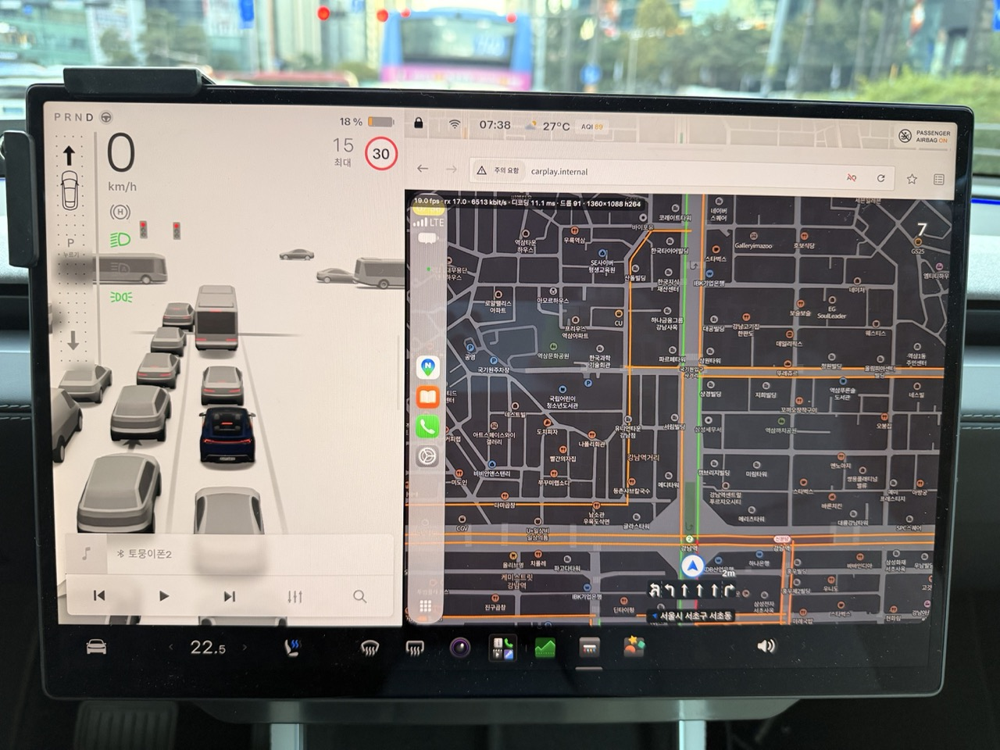

# Carlinkit T2C — Tesla web UI rebuild



*Wireless CarPlay in a Tesla: the car's browser open on `http://carplay.internal/` (this firmware's page, H.264 video from the iPhone decoded in the browser), the Tesla UI on the left.*

Custom firmware build for the Carlinkit **T2C** (TesPush T2C, hardware branch `1508`) that
replaces the adapter's Tesla‑browser web interface and the phone‑facing settings page.
The device binaries are untouched; only `app/www` (Tesla page) and `ota/www` (phone page
at `http://192.168.3.1/`) inside the `customer` squashfs partition are rebuilt. The stock
`index.cgi` keeps handling settings and firmware upload; a small shell CGI adds reboot,
password change, log download and diagnostics.

## First installation (how to)

The easiest way is the installer page: **https://taylor224.github.io/cpc200-t2c/**

1. Open the page on your phone or laptop while it still has internet and press
   *Download latest firmware* (about 8 MB, `T2C-tesla-ui-YYMMDDNN.img`).
2. Power the T2C (in the car or from any USB charger) and join its Wi‑Fi
   (`AutoKit_xxxx` / `TesPush_xxxx`; password printed on the adapter, default `88888888`,
   or whatever you set in the Carlinkit app). Keep the page open.
3. Back on the page, choose the downloaded file and press *Install on the adapter*. The
   browser warns that `http://192.168.3.1` is not secure — that is the adapter on your
   local network; confirm. A new tab shows the adapter's reply:
   `{"code": 0, "msg": "upload successful"}` means it was accepted.
4. Wait about five minutes. The adapter checks the file, reboots into recovery, writes
   the firmware and reboots again (its Wi‑Fi disappears for ~30 s in the middle).

Afterwards `http://192.168.3.1` (or `http://setting.internal/`) is the new settings page and
the car browser shows the new CarPlay page at `tespush.com` (HTTPS) or — without TLS —
`http://101.200.208.6/` (the address the adapter answers for on its own Wi‑Fi; works whatever
DNS the car uses) or `http://carplay.internal/` (needs the car to ask the adapter's DNS, or the
watchdog's `.internal` redirect — see NOTES; type `http://` or the trailing slash the first time so
the browser does not run a search). Later updates are one tap: in the car
*Settings → About → Check for updates*, or on the settings page *Software → Check for
updates*; both read `updates/1508/version.json` from this repository and install the image
linked there. While the page on GitHub cannot see the adapter (see below), it shows the
install stages on a timer; the adapter's own settings page shows them from the adapter's
state.

Why the two steps: the installer is served over HTTPS and browsers refuse to send
requests from an HTTPS page to the adapter's plain‑HTTP address (mixed content), so the
page cannot upload with JavaScript; a normal form submission is allowed after the warning.
Once this firmware is on the adapter, its own page is plain HTTP and updates itself.

Command‑line alternative, on a computer joined to the adapter's Wi‑Fi:

```
tools/flash.sh T2C-tesla-ui-YYMMDDNN.img --yes          # pre-flight checks, upload, wait
curl -F 'file=@T2C-tesla-ui-YYMMDDNN.img;filename=update.img' \
     'http://192.168.3.1/cgi-bin/index.cgi?id=upload'   # bare upload
```

Only for firmware branch **1508** (`http://192.168.3.1/cgi-bin/index.cgi?id=host` shows a
version like `2609….1508.x`). There is no A/B fallback; keep the adapter powered.

## Recovery (the adapter no longer shows its Wi‑Fi)

When the adapter's hotspot never appears (no `AutoKit_xxxx` network, the Wi‑Fi LED stays
dark) nothing in this firmware can reach it any more: the settings page, the car page and the
updater all sit behind that hotspot. (26101719–26101723 did this to every adapter whose Wi‑Fi
password had never been changed; fixed in 26101724, see `docs/NOTES.md`.) The way back is
Allwinner's USB flashing tool **PhoenixSuit** with Carlinkit's factory image, the procedure
Carlinkit documents at <https://www.carlinkit.com/faq_detail/145.html> (video:
<https://youtu.be/zcg8meuj6YQ>). The files are mirrored in this repository's
[**recovery-tools** release](https://github.com/taylor224/cpc200-t2c/releases/tag/recovery-tools)
so they stay available if that page goes away:

| File | What it is | SHA‑256 |
|---|---|---|
| [PhoenixSuit_CN.zip](https://github.com/taylor224/cpc200-t2c/releases/download/recovery-tools/PhoenixSuit_CN.zip) | PhoenixSuit installer (`PhoenixSuit_CN.msi`, Windows only, Chinese UI — the two items you need are *Firmware* and *Image*) | `b858cbc7aa11153746839a9b6622f0c094ca941099140c403f87da3a8d66966b` |
| [1508-20231209.zip](https://github.com/taylor224/cpc200-t2c/releases/download/recovery-tools/1508-20231209.zip) | factory image for hardware branch **1508** — `1508_20231209.img` is the whole flash (vendor firmware `23120914.1508.1`), plus that version's OTA file `update.img` and the vendor release notes | `122deaebfa91625a67b655e5a1df2b9a1173174d938c84c240238dad35f63721` |
| [1552-20231212.zip](https://github.com/taylor224/cpc200-t2c/releases/download/recovery-tools/1552-20231212.zip) | the same for branch **1552**, Carlinkit's other T2C hardware version. This project does not run on it; kept only so both of Carlinkit's files survive | `5dd1adf9f1196a68b4998f0b9eacd785437c56c6ffacbfd0378437d3a71e47a6` |

You need a Windows PC, a USB‑C **data** cable and a SIM‑eject pin or a paper clip.

1. Install PhoenixSuit from the archive and start it.
2. *Firmware* → *Image* → pick `1508_20231209.img` from the 1508 archive. A T2C that ran this
   firmware is a 1508 unit (`index.cgi?id=host` showed `….1508.x`); the 1552 image belongs to
   the other hardware version — do not flash it on a 1508 unit.
3. Find the reset hole on the side of the adapter that carries the product label. Push the pin
   in until it clicks, keep it pressed, and while holding it plug the adapter into the PC with
   the data cable.
4. PhoenixSuit asks whether to format the device: answer *Yes*. The pin can be released now.
5. Click *Firmware* to start. The write takes about six minutes; it sits at 7 % for a long time
   and the adapter's LEDs stay dark while it runs — normal, do not unplug.
6. When PhoenixSuit reports completion the LEDs come back and the adapter boots the factory
   firmware. Everything on it is gone: phone pairings, the Wi‑Fi password (back to `88888888`),
   channel, car name. Pair the phone again, then install this firmware as in *First installation*
   above — the factory `23120914.1508.1` accepts the image the same way.

If PhoenixSuit never shows the connection prompt, try another cable and USB port first. On the
development unit the PC saw nothing in this mode either (the USB data lines did not seem to reach
the connector, NOTES › USB device mode); such a unit can only be recovered with an SPI programmer
on the flash chip.

## Why

Tesla software 2026.26 moved the in‑car browser to Chromium 148 and changed its pixel
density (DPR 1.0 → 1.53, CSS viewport 1920×1200 → 1254×784, or 773×601 when docked next
to the map). The stock T2C page assumed a ≥1024 px wide layout, sized its video surface
from the browser's reported width, requested a square 800×800 CarPlay session in picture
mode and stretched it to the window. Results: the right side cut off, a distorted picture,
and a page reload loop on resize. Carlinkit has not shipped a fix.

## What changed

**Fit the Tesla browser**
- The layout is viewport‑driven; the root font size is derived from `devicePixelRatio`
  so the UI keeps the same physical size before and after the Tesla density change.
- The CarPlay session size is requested from the browser: *Balanced* (default) matches
  the browser viewport, *Sharp* matches physical pixels (1:1 on the Tesla screen),
  *Data saver* is 0.75×, *Low* is 0.6×, *Device* restores the adapter's own HD/SD/Auto presets.
  The session always has the viewport's aspect ratio, so nothing is cropped or stretched.
- Picture fit (Fit / Fill / Stretch) is a user choice; touch coordinates are mapped
  through the same rule.

**Smoother, lower‑latency picture**
- MJPEG (`/video.jpg`) is consumed with a streaming `fetch` reader, decoded off the
  main thread with `createImageBitmap`, and painted the moment the bitmap is ready on
  a desynchronized canvas. Only the newest frame is decoded; stale frames are dropped,
  so latency never accumulates and the TCP stream never stalls the adapter.
- **H.264 in the browser without WebCodecs.** The adapter's "video" mode forwards the
  iPhone's H.264 stream unchanged over the WebSocket. This UI decodes it in a Web Worker
  with FFmpeg's h264 decoder compiled to WebAssembly (`tools/build-h264dec.sh`, SIMD) and
  paints the YUV planes through a WebGL shader on an OffscreenCanvas. Result: 3–5× less
  Wi‑Fi bandwidth than MJPEG and no transcoding inside the adapter. *Video transport*
  in Display settings is Automatic by default: H.264 when the browser has WebAssembly
  SIMD + OffscreenCanvas + WebGL, MJPEG otherwise; if the decoder cannot keep up (more
  than 40 % of frames dropped for 5 s) it switches back to MJPEG and remembers that for
  a week. Picture / Video force one transport.
- Wi‑Fi: a wrapper around the adapter's `hostapd` (`src/app/hostapd`) runs the 5 GHz
  channels 36–48 and 149–161 at 40 MHz with the correct HT40 pairing (stock is 802.11n with
  `[HT40+]` on every channel, which left the default channel 161 at 20 MHz). Both channel
  pickers mark those channels as recommended. 802.11ac 80 MHz was tried: hostapd sets it up,
  but the adapter's Realtek driver drops the VHT elements and runs 40 MHz regardless, so it
  stays behind an experiment flag (see NOTES). The wrapper falls back to the stock file when
  hostapd refuses a configuration or no station is associated within five minutes; lylinkui's
  own hostapd restarts (idle sleep, phone reconnect) re-enter it. Bench-tested, not yet in a car.
- **The CarPlay session survives the car browser.** Closing and reopening the Tesla browser used to
  stop the session twice (the adapter "took" the screen when the page's socket closed, and the
  reloaded page made it set the screen up again) and navigation routes were lost each time. Now the
  adapter leaves a running session alone when the page goes (`tools/patch_lylinkui.py` patches 12/14),
  the hidden page keeps its socket and only pauses decoding, and coming back costs one key frame. A
  page that was displaced by another screen reconnects by itself (3 s … 60 s backoff, only while
  visible) instead of asking; two pages now alternate without restarting CarPlay.
- The adapter's **Wi‑Fi no longer sleeps**: stock lylinkui killed hostapd two minutes after the last
  phone/page and only relaunched it when the phone came back over Bluetooth; a failure in that chain
  left the adapter without Wi‑Fi until a power cycle (patch 13). A watchdog (`src/app/t2c_watchdog.sh`)
  relaunches gocsdk (Bluetooth) or hostapd when either disappears and writes a health log the phone
  page can show (`health`, `health_saved`, `watchdog`, `thermal`, `btaudio`).
- A decoder that cannot keep up (Sharp × Smooth on an Intel-era car) steps down — frame rate to
  Standard, then picture size to Balanced — before it ever falls back to MJPEG (now for a day, not a
  week). A Wi‑Fi dropout is no longer mistaken for that: the decoder module is fetched again when
  the connection is back, frames are ignored until the decoder is ready, and a failed worker is
  rebuilt instead of being remembered as "this browser cannot decode video". About › *Recent
  events* keeps the last 80 connection/takeover/restart/step-down events.
- `lylinkui` no longer piles up the CarPlay video stream while no page is watching (stock
  parked its IPC thread on a condition variable whenever the stream was active but no page had
  asked for video, so the phone's frames queued up inside the process until the kernel's OOM
  killer stopped it and CarPlay reconnected every few minutes — taking the adapter's DNS and the
  Bluetooth-PAN internet with it; `tools/patch_lylinkui.py` patch 10), and the queue of units
  waiting for the page is capped at 10: beyond that the adapter drops until the next key frame
  and asks the phone for one, so a page that falls behind gets a short freeze instead of
  ever-growing lag (patch 11).
- The adapter's WebSocket server (`lylinkui`) sends one message per H.264 access unit instead
  of 8 KB pieces in 4 KB socket writes (`tools/patch_lylinkui.py`; `T2C_WS_PATCH=0` builds
  without it). Measured with a test client: frame gaps p95 52 ms instead of 125–152 ms with the
  stock fragmentation, which showed up as stutter.
- Touch moves are coalesced per animation frame; pointer events with capture.
- A performance overlay (fps, bandwidth, decode time, dropped frames) can be toggled in
  Display settings.

**New interface** (per `DESIGN.md`, Tesla‑style)
- White canvas, Electric Blue accent, 4 px controls, 12 px surfaces, no shadows, plus a
  Carbon Dark theme that can follow the CarPlay night‑mode schedule.
- A pairing screen with the Bluetooth name, steps, status, and a QR card.
- Settings: Devices, Cellular, Wi‑Fi (password/channel), Bluetooth modem, Display,
  Language, System (car name/icon), About (update, factory reset).

**Languages**: English, 简体中文, 繁體中文, 한국어, 日本語 (client‑side; the adapter can
only persist zh‑CN/zh‑TW/en, so the choice is kept in the browser's storage).

**Firmware update server**: both pages read `<base>/<branch>/version.json` (branch `1508`),
default base `https://raw.githubusercontent.com/taylor224/cpc200-t2c/main/updates`
(`CONFIG.UPDATE_BASE_URL` in `src/www/js/app.js` and `src/ota-www/js/ota.js`). It is fixed:
neither page accepts another server (no URL parameter, no settings field), so nobody with
access to the car's screen or the hotspot can point the updater at a foreign image.
`updates/1508/version.json` carries `appver` (compared by the phone page), `tsl`
(compared by the Tesla page), `url` and `msg`. `url` points at the copy of the image on the
orphan `releases` branch (served by raw.githubusercontent.com with CORS headers; GitHub
release assets are not, so a browser cannot fetch them); the same file is attached to the
GitHub release for manual download. Build a release
with `T2C_VERSION=YYMMDDNN tools/build.sh`, which stamps that date into `app/system.json`
so the adapter reports the new version afterwards. `tools/release.sh YYMMDDNN [NOTES.md]` does the whole
cycle: build, rewrite `version.json`, commit, push, GitHub release with the image attached.

**Phone page (`http://192.168.3.1/`, `src/ota-www`)**
- Same design language as the Tesla page, five languages, dark mode follows the phone.
- Status (network, channel, firmware, hardware, UUID, uptime, memory, connected devices),
  resolution and channel (stock `index.cgi?id=set`), **device name** (Bluetooth name and
  CarPlay car name, 1–12 of `A‑Z a‑z 0‑9 space _ . -`; reboots), **reboot**, **Wi‑Fi
  password change** (writes the adapter's own settings file and reboots; the network name is
  derived by the firmware and stays as it is), factory reset with confirmation, plain‑text
  log download, diagnostics (hostapd config, settings file, MTD table, mounts, processes,
  U‑Boot env, DNS …), update check, install from the server or from a local file with
  staged progress (download, send, check, write/reboot, done; elapsed and remaining time). The feedback upload to Carlinkit's cloud and the 536 KB Aliyun SDK
  are gone.
- `cgi-bin/t2c.cgi` only knows fixed actions (`info`, `reboot`, `log`, `cat&f=<name>` from a
  whitelist, `wifi`, `channel`, `name`, `unname`); nothing from the request reaches a shell
  command, and the name is checked against a fixed character set before it is stored.
- The adapter stores the Wi‑Fi password in a 12‑byte field, so passwords are 8–11
  characters on both pages (the stock Tesla page allowed 12, which overflowed the field).

## Not changed / limitations

- **Audio and microphone are not routed through the browser.** CarPlay audio goes
  iPhone → T2C → Tesla over Bluetooth (A2DP for media, HFP for calls/Siri), and the car's
  microphone comes back over the same HFP link. The Tesla browser blocks `getUserMedia`
  at compile time, and the adapter firmware has no audio path over the WebSocket, so
  the microphone path is the Tesla's own Bluetooth link to the iPhone (the adapter's stack has no
  hands‑free gateway role, so the car never connects to it as to a phone — see NOTES › Audio). Siri
  switching the car into its phone‑call audio mode is inherent: HFP is Bluetooth's only microphone
  path (A2DP is one‑way), and the 8 kHz narrowband voice is what the Tesla negotiates with the
  iPhone; nothing in this firmware can change it.
- The WebAssembly decoder runs single‑threaded (the adapter's server cannot send the
  COOP/COEP headers needed for threads). Intel‑era cars (MCU2) may not sustain 30 fps
  at the *Sharp* size; use *Balanced* or let Automatic fall back to MJPEG. JPEG quality
  in MJPEG mode is fixed inside the adapter binaries.
- The `customer` squashfs grows by about 250 KB (6.07 → 6.31 MB; xz compresses the decoder well).
  The partition is 6,553,600 B on the 16 MiB SPI NOR of the tested unit (236 KB spare), and the
  kernel fills its `boot` partition to within 4 KB — do not add to `kernel`. `tools/flash.sh`
  reads the layout from the adapter's own boot log and refuses to upload an image that does not fit.

## Rust sidecar (`rust/t2cd`)

The first piece of the planned `lylinkui` replacement (`docs/REWRITE-PLAN.md`): a static Rust
daemon that forwards the car's DNS (`carplay.internal` and `setting.internal` answered locally,
everything else relayed to the phone's resolvers) and keeps the nat rule that sends the car's
port‑53 traffic to it. Built with `cargo build --release --target armv7-unknown-linux-musleabihf`
(no C toolchain), shipped as `app/t2cd` when present, uploadable to the adapter without a flash
(`rust/README.md`). It also serves the debug shell: flag `t2c_shell` → root shell on tcp/2323 for
hotspot clients, `tools/shell.py` (the rootfs busybox has no telnetd/nc). Device-tested 2026-10-18.

## Build

```
brew install squashfs            # unsquashfs / mksquashfs
cp /path/to/update.img .         # official 1508 image (test.img is also accepted)
python3 test/check.py            # static checks
tools/build.sh test.img build/T2C-tesla-ui.img
```

`tools/build.sh` unpacks the image (`md5 line + SWUpdate CPIO`), extracts the `customer`
squashfs, replaces `app/www`, repacks with the original parameters (xz, 256 KiB blocks,
root‑owned 0755) and verifies the result (`tools/verify.sh`).

The H.264 decoder (`src/www/js/h264dec.js` + `h264dec.wasm.txt`) is a committed build
artifact. To rebuild it: `brew install emscripten` (needs Python ≥ 3.10) and run
`tools/build-h264dec.sh`; it downloads FFmpeg 7.1.1 from ffmpeg.org, checks the pinned
SHA‑256, builds only the h264 decoder with `-O3 -msimd128`, and links `tools/h264dec/decoder.c`.
The `.txt` extension is deliberate: the adapter's libwebsockets 3.2 refuses to serve
extensions it does not know, and `.wasm` is not in its table.

## Flash

Join the adapter's Wi‑Fi (`AutoKit_xxxx`, password printed on the device or set in the
phone app), power‑cycle the adapter so its boot log still holds the partition table, then:

```
tools/flash.sh build/T2C-tesla-ui.img          # pre-flight only: version, image, partition sizes
tools/flash.sh build/T2C-tesla-ui.img --yes    # upload, then wait for the adapter to return
```

The script uploads to the OTA endpoint (`POST /cgi-bin/index.cgi?id=upload`), expects
`{"code": 0, "msg": "upload successful"}`, and watches for the reboot. Keep the adapter
powered: `id=host` shows `update: 2` for a few minutes, the adapter then drops off for
about half a minute while recovery writes `boot` + `customer`, and comes back on the new
version. Only use this on firmware branch **1508**. There is no A/B fallback.

Tested on 2026‑10‑15 on a 1508 unit: flashed from `26020416.1508.1`, came back as
`26090414.1508.1` serving the new UI; the iPhone reconnected and the H.264 path ran at
about 2 ms decode per frame in a Chromium 155 test at the Tesla viewport.

## Develop

```
python3 tools/devserver.py --frames /path/to/jpegs --link-after 4        # MJPEG mock
python3 tools/devserver.py --mode video --h264 stream.h264 --link-after 2  # H.264 mock
ffmpeg -f lavfi -i testsrc2=size=1184x912:rate=30 -t 4 -c:v libx264 -profile:v high \
  -x264-params keyint=30:repeat-headers=1:annexb=1:bframes=0 -f h264 stream.h264   # mock stream
```

The simulator reproduces the adapter's templating, WebSocket protocol, `/video.jpg`
stream, Bluetooth list and firmware upload endpoints. `tools/cdp.py` drives a headless
Chrome for screenshots at Tesla viewports (`--metrics 773x601x1.53`).

## Layout

```
src/www/          new web UI (index.in, css/, js/, lan/, icon/, img/)
tools/swu.py      unpack / repack the .img container
tools/build.sh    full build pipeline     tools/verify.sh   image checks
tools/devserver.py  adapter simulator     tools/cdp.py      headless Chrome driver
test/check.py     static checks (tokens, ids, i18n parity, syntax, size)
docs/NOTES.md     reverse‑engineering notes (protocol, template engine, session sizing)
docs/original-www/  the stock web UI from firmware 26090414.5.4 for reference
```
